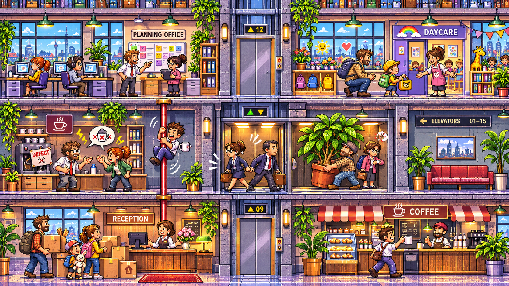

# Silly Office – Spielkonzept

*Silly Office* ist ein Aufbauspiel über eine Stadt in einem einzigen Hochhaus. Du mietest Abschnitte an, widmest Flächen und verbindest Stockwerke. Wer dort einzieht, welchen Weg jemand zur Arbeit nimmt und wie die Buchhaltung an ihren Kaffee kommt, entscheiden die Menschen selbst. Der schönste Moment darf einer sein, in dem du gerade gar nichts baust.

## So fühlt sich das Spiel an

Am Montagmorgen öffnet sich im zehnten Stock der Expresslift. Zwei Pendler wollen aussteigen. Draußen versucht ein neuer Mieter, einen Ficus samt Topf in die Kabine zu bugsieren. Eine Frau wirft einen Blick auf ihre Uhr. Ein Klick auf das Symbol über ihrem Kopf verrät, dass sie hier seit Tagen beim Umsteigen Zeit verliert. Du könntest die freie Fläche nebenan anmieten und den Gang verbreitern. Während du darüber nachdenkst, rutscht hinter ihrem Rücken ein Kollege mit einem leeren Becher eine Stange hinunter. Die Kaffeemaschine oben ist schon wieder kaputt.

Das Gewusel hat nachvollziehbare Ursachen. Wer lange genug zusieht, erkennt Wege, Gewohnheiten und Engstellen. Die Aufbaustrategie ergibt sich aus diesen Beobachtungen. Die Wirtschaft soll zum Abwägen einladen und dem Spieler Spielraum für kuriose Lösungen lassen.

## Vom leeren Haus zum ersten Arbeitstag

Am Anfang ist das Hochhaus leer. Nur die Rezeption im Erdgeschoss ist besetzt. Dort warten die ersten Interessenten für Wohnraum und Büros. Ein Klick zeigt, was sie brauchen. Wohnungen und erreichbare Arbeitsplätze genügen zu Beginn. Anforderungen wie Schule oder Kindergarten kommen später hinzu.

Freie Abschnitte sind im Gebäudeschnitt bereits als Grundstruktur sichtbar. Du erkennst Ausdehnung, Geschosse, Zugänge und Hindernisse, bevor du mietest. Jenseits deines Bereichs setzt sich der Komplex nach oben, links und rechts fort. Seine Form kann dazu führen, dass ein Raum hinter der nächsten Wand über das vorhandene Treppenhaus nur mit einem erheblichen Umweg erreichbar ist.

Du mietest einen ersten Abschnitt und widmest Flächen für Wohnen und Arbeiten. Passende Mieter ziehen selbstständig ein. Der erste Arbeitsweg soll vollständig zu beobachten sein, von der Wohnungstür über die Treppe bis ins Büro. Für den ersten spielbaren Ausschnitt schlage ich vor, Wohnung und Arbeitsplatz gemeinsam zu vergeben, sobald beide über die Treppe erreichbar sind. So kommt der erste Arbeitstag in Gang, auch wenn das Haus anfangs leer ist.

## Anmieten, widmen und zurückgeben

| Entscheidung | Wirkung im Haus |
| --- | --- |
| Abschnitt anmieten | Der Bereich wird nutzbar und verursacht laufende Miete. Seine Geometrie und Anschlüsse bestimmen, was du mit ihm anfangen kannst. |
| Flächen widmen | Wohnungen, Arbeitsplätze, Einkauf und Freizeit geben dem Alltag seine Ziele. Spätere Freischaltungen ergänzen etwa Kindergarten und Schule. Interessenten wählen selbst passende Flächen. |
| Platz für Wege lassen | Ein Stück Gang kann zwei Gebäudeflügel verbinden. Eine freie Fläche vor mehreren Aufzügen gibt Menschen Platz zum Umsteigen. Auch Flächen ohne eigenen Mieter können sich dadurch lohnen. |
| Abschnitt zurückgeben | Die dortigen Mieter ziehen aus. Der Abschnitt erhält seinen ursprünglichen freien Zustand zurück und kann später neu angemietet werden. Wege, die seine Nutzung voraussetzen, fallen weg. Andere Mieter bewerten ihre erreichbaren Ziele neu. |

Für die Wirtschaft schlage ich eine gemeinsame Hauskasse vor. Belegte Flächen bringen Mieteinnahmen. Dadurch kann ein gut belegter Flügel die Anlaufzeit einer neuen Passage finanzieren. Vor einer Rückgabe siehst du die eingesparte Miete, betroffene Mieter und verlorene Verbindungen. Die Rezeption bleibt als Ausgangspunkt verfügbar. Miethöhen und zeitlicher Spielraum gehören ins Balancing.

## Menschen, Bedürfnisse und Eigeninitiative

Jede Person sucht ihre Wege selbst. Für die Wohnortwahl zählen die tatsächlich erreichbaren Annehmlichkeiten. Eine Familie kann eine weiter entfernte Wohnung bevorzugen, wenn sie von dort Kindergarten, Arbeit und Einkauf gut miteinander verbinden kann. Ein Umstieg mit täglichem Gedränge verschlechtert diesen Alltag.

Ein Symbol erscheint bei der betroffenen Person oder am betroffenen Ort. Beim Anklicken wird der Anlass konkret. Die Person erklärt etwa „Beim Umsteigen komme ich morgens kaum aus dem Lift.“ Am Umsteigebereich lässt sich erkennen, welche Wege sich dort stauen. Kurzer Ärger darf wieder verfliegen. Wiederkehrende Probleme senken die Zufriedenheit. Erst wenn die Unzufriedenheit lange anhält und schwer wiegt, zieht ein Mieter aus eigenem Entschluss aus.

Meistens versuchen die Leute vorher, sich selbst zu helfen. Wer einen langen Umweg regelmäßig zurücklegen muss, kann zusammen mit anderen eine Abkürzung schaffen. Eine Rutschstange führt hinunter, eine Außenleiter verbindet benachbarte Ebenen, ein Portal kann zwei weit auseinanderliegende Gänge direkt verbinden. **Diese Verbindungen gehören den Bewohnern.** Der Spieler platziert, versetzt und entfernt sie nicht einzeln. Er kann beobachten, wo sich die Wege anschließend bündeln, und beispielsweise dort Einkauf widmen. Eine Rückgabe setzt den Abschnitt als Ganzes zurück.

## Aufzüge und „Aufzugsbahnhöfe“

Zu Beginn reichen Treppen für die ersten Geschosse. Reguläre Aufzüge schaltet der Spieler frei und platziert sie selbst. Dazu braucht er über die bedienten Ebenen hinweg Platz an derselben Stelle. Manche Geschosse haben bauliche Besonderheiten, die einen Halt für bestimmte Lifttypen ausschließen. Vor dem Anmieten zeigt der Gebäudeschnitt, wo Platz für einen durchgehenden Schacht ist und auf welchen Ebenen der gewählte Lift halten kann. Für den einfachen Lift muss jeder Halt möglich sein. Sonst endet die Linie vor diesem Geschoss und die Treppe übernimmt den Anschluss.

| Entwicklungsstufe | Bedeutung für den Grundriss |
| --- | --- |
| Treppen | Der erste Arbeitsweg funktioniert zu Fuß. Ungünstige Anordnung wird früh sichtbar. |
| Paternoster, mögliche Zwischenstufe | Offene, umlaufende Kabinen bringen schon bei wenigen Geschossen sichtbare Bewegung ins Haus. |
| Einfacher Aufzug | Er hält auf jedem erschlossenen Stockwerk und bedient höchstens 15 Stockwerke. Sein Schacht braucht auf jeder dieser Ebenen Platz für den Halt. |
| Weiter reichender normaler Lift | Er bedient mehr als 15 Stockwerke und erschließt auch die Zwischenetagen. |
| Expresslift | Er bedient nur jedes zehnte Stockwerk. Für die übrigen Etagen steigen die Fahrgäste selbstständig um oder gehen zu Fuß weiter. |

Ein „Aufzugsbahnhof“ entsteht dort, wo Menschen zwischen Liften wechseln. Der Spieler entscheidet über Schachtpositionen und den Platz zwischen den Türen. Fahrgäste finden ihre Anschlüsse selbst. Wartende und Aussteigende beanspruchen denselben Raum. Wenn sich die Schlange bis vor die nächste Tür staut, werden die Menschen ärgerlich. Nach einer Verbreiterung soll im selben Blickausschnitt zu erkennen sein, wie sich die Menge schneller verteilt.

## Wachstum und Freischaltungen

Mit zunehmender Bevölkerung verdient der Spieler Punkte für einen Entwicklungsbaum. Er entscheidet, wann er etwa Aufzüge, leistungsfähigere Lifte oder neue Einrichtungen freischaltet. Eine Freischaltung kann zugleich Nachfrage erzeugen. Mit dem Kindergarten treten etwa erstmals Familien an der Rezeption auf, die einen erreichbaren Kitaplatz voraussetzen. Ein neuer Lift verändert dagegen zunächst, welche Wege für die bisherigen und künftigen Mieter attraktiv sind.

Für die Erprobung schlage ich vor, beim erstmaligen Erreichen einer Bevölkerungsmarke Punkte zu vergeben. Zieht ein Mieter aus, bleiben erworbene Freischaltungen bestehen. Die langfristige Motivation liegt im Weiterentwickeln des eigenen Komplexes und im Entdecken neuer Bewohnergeschichten.

## Verbindliche Bildsprache

Das direkt angehängte und hier eingebundene Bild legt den Look fest. Das Gebäude erscheint frontal aufgeschnitten. Decken, Böden und durchgehende Schächte gliedern die Geschosse. Die Räume haben sichtbare Tiefe, warmes Licht, eigenständige Einrichtungen und Ausblicke auf die Stadt. Moderne, hochauflösende Pixelgrafik gibt selbst kleinen Figuren lesbare Augenbrauen, Hände, Blicke und Körperhaltungen. Die Kaffeemaschine und der Ficus sind bereits an ihrer Silhouette zu erkennen. In der Übersicht bleiben Wege und Menschenmengen lesbar, beim Heranzoomen lohnt sich der Blick auf Gesten und Gegenstände.

Drei Ansätze haben die Entscheidung geprägt. Die kompakte Pixelansicht betonte das Wuseln, verlor aber feine Gesten. Das schräge Miniatur-Diorama machte räumliche Tiefe anschaulich, überdeckte jedoch Teile der unteren Etage. Am illustrierten Querschnitt gefiel die klare Raumaufteilung, sein ursprünglicher Zeichenstil wurde verworfen. Die ausgewählte Referenz verbindet diesen Querschnitt mit detaillierter moderner Pixelgrafik. Sie ist auch der Maßstab für die Animation. Ein Fahrgast dreht die Schultern, um am Ficus vorbeizukommen. Dadurch lässt sich das Problem schon vor dem ersten Symbol verstehen.

## Erster spielbarer Ausschnitt

Für die erste spielbare Fassung schlage ich ein Haus mit Rezeption, mehreren übereinanderliegenden Geschossen und einem anmietbaren Seitenflügel vor. Ein handgebauter Grundriss legt Büro und Kaffeekiosk auf benachbarte Etagen, die zunächst nur über eine Treppe am anderen Ende des Flügels verbunden sind. So lässt sich derselbe Kaffeegang vor und nach dem Bau der Rutschstange beobachten. Eine erste Aufzugsfreischaltung, eine von Bewohnern geschaffene Rutschstange und die Rückgabe eines Abschnitts machen die wichtigsten Entscheidungen erlebbar.

Beim ersten Probespiel sollen diese Situationen im Haus zu beobachten sein.

- Eine Person wartet an der Rezeption, zieht wegen einer passenden Widmung ein und erreicht zu Fuß ihren Arbeitsplatz.
- Der erste selbst platzierte Lift verändert einen zuvor beobachteten Weg. Eine Warteschlange erklärt sich durch Türen, Personen und verfügbaren Platz. Ein Klick auf eine verärgerte Person macht den konkreten Grund verständlich.
- Ein wiederkehrender Umweg führt zu einer eigenständig gebauten Abkürzung. Auch ohne Spielereingriff lässt sich erkennen, wer sie wofür benutzt.
- Ein schwach belegter Flügel kostet laufend Geld. Nach seiner Rückgabe ziehen die betroffenen Mieter aus, die Fläche ist wieder anmietbar und die verbleibenden Menschen suchen verfügbare Wege.
- In einem kurzen Abschnitt ohne Eingabe sind gleichzeitig mindestens zwei unterschiedliche, verständliche Alltagshandlungen zu entdecken. Die finale Stilreferenz bleibt in Übersicht und Nahansicht wiedererkennbar.

Zielplattform und Engine sind technische Entscheidungen für die Umsetzungsplanung. Am ersten spielbaren Haus lassen sich Mietpreise, Punkteschwellen, Wartezeiten, Kapazitäten und die Auslöser für Abkürzungen und Auszug abstimmen. Ob der Paternoster eine eigene Entwicklungsstufe verdient, bleibt offen. Die wichtigste Frage beim Probespielen ist, ob man einer einzelnen Person bis zu ihrem Ziel folgen möchte.
